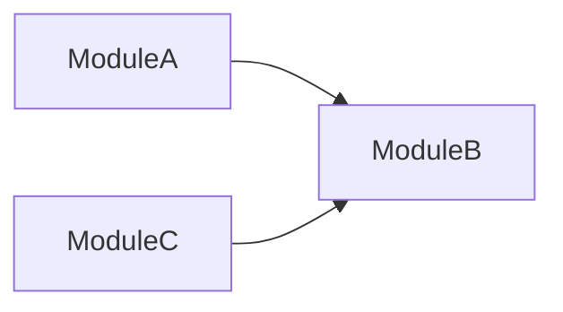
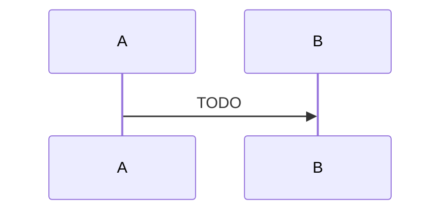

<!--
  КАК ПОЛЬЗОВАТЬСЯ КАРКАСОМ
  - Комментарии <!-- --> не рендерятся на GitHub, но видны в исходнике: удали их перед публикацией.
  - Перед публикацией проверь: grep -n "TODO" README.md должен вернуть пусто.
  - README пиши на английском (целевая аудитория - международные студии).
  - Первый экран (до "Technical highlights") должен читаться за 30 секунд.
  - Глубину выноси в docs/, в README оставляй суть и ссылки.
-->

# Clarity

> A third-person shooter vertical slice in Unreal Engine 5 (C++): squad AI, contextual-animation disarm takedowns, and a GAS-inspired action system.


[Gameplay video](https://youtu.be/h4d0k1E8yDU?si=f3z6sPXBCsB33y-Q) · [Architecture](#architecture) · [Code map](#code-map)

## About

Clarity is a solo-built third-person shooter vertical slice in Unreal Engine 5. I started it to learn the engine's C++ layer in depth, so the emphasis is on gameplay architecture rather than content.

The slice includes:
- shooting with ballistics and hit reactions
- squad AI: Behavior Trees, AI Perception, cover rotation
- animation integration: Motion Matching, Contextual Animation, Motion Warping (disarm takedown)
<!-- add profiling later -->

It took about 5 months working part-time.

**My role:** sole developer: gameplay, AI and animation-integration programming, game design.
**Not mine:** animation sequences, the level, and cosmetic assets. See [Credits](#credits--license).

---

### Action System


**How it works**
A GAS-inspired system written from scratch (not a fork of GAS), built by breaking GAS down to understand its trade-offs. Each behavior (shooting, reloading, death, disarm, etc) is a `UCAction` subclass. `UCActionComponent` on the actor owns the actions and runs their lifecycle (`CanStartAction` → `StartAction` → `StopAction`). Actions are gated and cancelled through GameplayTags, and the player and AI use the same system. The component/action split follows the pattern from Tom Looman's Unreal C++ course; i've added gameplay tag registration to implement tags additions/removal delegates, starting action with data-bus, using the InstancedStruct (see [`FActionEventData`](Source/Clarity/Public/ActionSystem/CActionSystemTypes.h) and action cancel by tag).

`CanStartAction` is limited to cheap checks (asset presence, owner state, tags); anything expensive, such as line traces, runs in `StartAction`. ███[4]

**Why this way**
- **Problem:** Player and AI both need to shoot, reload, die and disarm under shared rules about what can run together and what interrupts what. Without a common layer, each behavior would carry its own state flags, and those rules would end up scattered across the codebase. For example, without single point of entry we would have to call the same logic from BTTask and Player's class, which leads to swelling the codebase and adding the probability of code duplication. Moreover, adding it to one system with single flow actions can interrupt each others easily (Reload to Fire, Aim to Run, etc).
- **Alternatives considered:**
  - Behavior logic directly in the character class and components, with state flags: same rules are scattered and duplicated, but not synchronised and some cases would be much harder to implement without the proper flow. Example: resetting actor's state after ending Aim would take another layer of logic instead of simple StopAction().
  - Unreal's Gameplay Ability System: the project is single-player by design, so GAS's prediction and replication give nothing here; ███[7]
- **Chosen:** a smaller GAS-inspired system, easier to navigate at this project's scale. It keeps tag-based gating and cancellation.
- **Cost / trade-off:**
  - Anything GAS provides that I need, I build and debug myself. Added on demand so far: action ticks, tag notifies.
  - I maintain code that GAS has already proven in shipped games; it would caused a lot of additional work for multiplayer, because the replication is not intendend by design.
  - Upside: each piece I add teaches me how the matching GAS feature works and why.

**Where to look**
1. [`UCActionComponent`](Source/Clarity/Public/ActionSystem/CActionComponent.h) — owns the actions, runs the lifecycle, holds the tag state
2. [`UCAction`](Source/Clarity/Public/ActionSystem/CAction.h) — base class for every behavior
3. [`UCAction_DisarmEnemy`](Source/Clarity/Public/ActionSystem/CAction_DisarmEnemy.h) — the most complex example: Contextual Animation, Motion Warping, time dilation

Used by shooting, reloading, death, disarm, hit reaction, sprint, aim, swap shoulder, zoom camera.

### Shooting & Ballistics


**How it works**
The most example part of Action System. The breakdown:
1. inital checks (CanStartAction())
2. Try to get the weapon from WeaponSlotsComponent
3. Get position and direction of the crosshair by defining whether shooter is AI or Player via Interface call. (The vector is caclulated in specific character classes. ex: Player calculates by using the crosshair screen position)
4. At the same time get the accuracy (always 100 for Player, tweakable for AI)
5. Perform crosshair line trace
6. Perform weapon line trace
7. Provide damage via AttributesComponent
8. Add fire cooldown tag to make the fire rate work.
(did not include cosmetic methods like PlayWeaponRecoil, PlayFireAnimation, etc)

**Why this way**
- Problem: The shooting system is crucial to TPS, so I've needed the hitscan shooting system that is suitable for both ai and player and is pretty rapid and easy to use.
- Alternatives considered: Projectile-based shooting system.
- Chosen: Projectile-based system is a rare case for guns like pistols and rifles, and it also it spawns objects, so I would have to implement something like Object Pooling.
- Cost / trade-off: None.

**Where to look:** [`CAction_Shoot`](Source/Clarity/Public/ActionSystem/CAction_Shoot.h)

### Physics-based Hit Reaction System


**How it works**
After getting the signal, system enables the collision and makes all the bodies rigid (except pelvis, so it won't fall down).
Then it perform the impulse from the hit (tweakable) and after some time (also tweakable) sets the physics off and collision back to original.
Note that the core technology for this system is Physical Animation. It is used to set the animation profile so it would look natural.

**Why this way**
- Problem: Need for realistic impact to make the shooting system more responsive. Also, to see where hit landed to make the limb damage feel fair.
- Alternatives considered: Hit animations.
- Chosen: Hit animation implies having an animator or specific skills. Otherwise, it would look boring to use the same 4-6 animations for hits. I don't have an animator neither animating skills.
- Cost / trade-off: PAC is still in beta (I think). So it caused a plenty of bugs, that I had to fix. Such as: PAC ticking problem, the unrealistic impulse, collision issues. All of them are fixed, but it was hell of an adventure.

**Where to look:** [`CHitReactionComponent`](Source/Clarity/Public/CHitReactionComponent.h)

### AI System


**How it works**
Every AI has a role: defender or an attacker (more roles will be added later). And also there is a [`manager`](Source/Clarity/Public/AI/CAIManagerSubsystem.h), that orchestrates the tactical movement of the defenders.
Defender's combat cycle:
1. Spot the target (by itself or by the info from the teammates via Manager)
2. Investigate the last seen target's location
3. If there is one, increase the detection level (time is tweakable) and tell others to set the Combat State to Attack (via Manager)
4. Find the nearest free cover.
5. Call for cover fire, try to take found cover.
6. Based on distance from cover (via blackboard key): if cover is too far, sprint to it. If it close enough, walk towards the cover while shooting the enemy.
7. When at cover, based on distance from target: if the target is too close, run EQS Query to move away from target and try to find the other cover, calling for cover fire via Manager.
8. Otherwise, sit at the cover and fire from the cover when Manager has requested.

Attacker's combat cycle is much simplier:
1. Spot the target (by itself or by the info from the teammates via Manager)
2. Investigate the last seen target's location
3. If there is one, increase the detection level (time is tweakable) and tell others to set the Combat State to Attack (via Manager)
4. If the target is far enough - move towards it while shooting
5. If got too close, then depends on exact distance and injuries:
     - if really close and was damaged, run EQS Query to find strafe location and strafe while shooting
     - if not that close and wasn't damaged, run EQS Query to create distance, then shoot
     - fallback: strafe on one place and shoot.

**Why this way**
- Problem: Every TPS has to have at least somewhat smart enemies, that are aware of surroundings and each other. Also, the role system must be scalable to add more roles, such as flanker.
- Alternatives considered: Basic AI to focus more on shooting mechanics.
- Chosen: Chose to implement more complex system to make project wider and look more like a game.
- Cost / trade-off: Had to cancel some shooter mechanics, like finishers. Moreover, the more system is complex, the more it needs to look better and appear smarter.

Every AI has to Enum States to rely on: AIState that is responsible for overall AI behavior (Investigate, Attack, Search, ManDown, LostWeapon, etc) and also CombatState that (as name suggests) is responsible for behaviour during combat.
All is managed by BehaviorTree, EQS, BlackboardBased Conditions.
All of the actions are done via custom [`BTTasks, BTServices and BTDecorators`](Source/Clarity/Public/AI) (it has some interesting coding features, such as [`latent tasks`](Source/Clarity/Private/AI/CBTTask_RangeAttack.cpp) or [`instanced node memories`](Source/Clarity/Private/AI/CBTTask_Reload.h))

**Where to look:** [`AI directory`](Source/Clarity/Public/AI)

### Weapon System & Data-Driven Design


**How it works**
Every weapon has its own class, derived from [`CWeaponBase`](Source/Clarity/Public/Weapons/CWeaponBase.h), which is responsible for managing ammo and adding basic structure to the child classes.

Actor's arsenal is managed by the [`CWeaponSlotsComponent`](Source/Clarity/Public/Weapons/CWeaponSlotsComponent.h). The component is responsible for adding weapons, equiping, switching weapons, lose weapons, etc. Somewhat of an inventory.

The one of the core principles of the weapon system is to supply weapon with its [`weapon data`](Source/Clarity/Public/Weapons/CWeaponData.h). It is a DataAsset class, that stores weapon's characteristics and other useful info.

It makes really easy to make the new weapon or a weapon variaton: 
1. Derive from CWeaponBase
2. Create specific CWeaponData
3. Fill it
4. ???
5. PROFIT

**Why this way**
- Problem: Modular and easy-to-use weapon system is a must-have. In future it is planned to add more guns: rifles, shotguns, etc. To make it easier and dependence-free, this system was designed.
- Alternatives considered: Stack the weapons in Actor's class.
- Chosen: Creates too many dependencies, violates the SRP badly, pretty sure that it is hard to scale later.
- Cost / trade-off: Had to deep-dive into DDD (which was pretty fun and useful).

**Where to look:** [`Weapons directory`](Source/Clarity/Public/Weapons)

### Disarm mechanic <!-- Disarm (CAS + Motion Warping + time dilation) -->


**How it works**
While no weapon in player's hand, he can come close enough to armed enemy and disarm him.
It works mostly via ContextualAnimation to synchronize the disarming animation and GameplayTags to tell to WeaponSystem when to unarm/arm.
Basically, when pressing the button, the Action performs a trace for an enemy, after which the animation is being started and the tags are being managed.
The animation itself has [`custom animation notify`](Source/Clarity/Private/Notifies/CAnimNotify_RetrieveWeapon.cpp) that is responsible for an actual Weapon Switch (it tells the WeaponSlotsComponent to switch the weapons between an attacker and a victim).
It also uses my other subsystem: [`the time dilation`](Source/Clarity/Public/CTimeDilationSubsystem.h) during the animation. But I've cut it out due to short length of the animation (it just looks strange).

**Why this way**
- Problem: TODO
- Alternatives considered: TODO
- Chosen: TODO
- Cost / trade-off: Right now, the notify uses the FindBindingByRole and some casts, which is probably is not very efficient, but the Action is performed not that often, so I think it is fine.

**Where to look:** [`CAction_DisarmEnemy`](Source/Clarity/Public/ActionSystem/CAction_DisarmEnemy.h)

### Smart object


**How it works**
Idea came from GDC's [`old presentation about AI behaviors`](https://www.gdcvault.com/play/1022230/Remember-to-Relax-Realizing-Relaxed). 
Game Designer can derive from SmartObject class to create an object, that can be dynamically added to the AI's Behavior Tree to interact with.
For example, I have [`patrol path`](Source/Clarity/Public/AI/CSmartObject_PatrolPath.h), that is a wrapper of a Spline to manage AI's patroling navigation. It has associated behavior in it (other BT), that will be pushed into AI's BT.

**Why this way**
- Problem: To make AI appear more smart and versatile we need some sort of dynamic behaviors.
- Alternatives considered: create more branches and/or subtrees in existing BT.
- Chosen: The alternative would swell the BT with optional logic. Also, it would require designing additional logic to make AI recognize the context and choose the branch.
- Cost / trade-off: Didn't find any.

**Where to look:** [`CSmartObject`](Source/Clarity/Public/AI/CSmartObject.h), [`CSmartObject_PatrolPath`](Source/Clarity/Public/AI/CSmartObject_PartolPath.h).

### Cover System


**How it works**
The cover system creates a sequence of smart objects, that AI can use to create more challenge for the player and make to look AI more coordinated and tactical.
Basically, AI can run the EQS to find the cover and take it by overlapping with the cover actor. AI Manager (as well as AIController and BT) uses this system heavily. 

**Why this way**
- Problem: TODO
- Alternatives considered: NONE
- Chosen: I DUNNO
- Cost / trade-off: THIS IS PERFECT

**Where to look:** [`CCoverActor`](Source/Clarity/Public/CCoverActor.h)


---

## Architecture

### Overview

<!-- Схема модулей, НЕ полная UML-диаграмма классов. Стрелка = "знает о / вызывает".
     Главное - направление зависимостей. 8-12 узлов максимум. -->



### Flow: TODO <!-- один сложный поток, например дизарм: вход -> действие -> анимация -> передача оружия -->



### Cross-cutting principles

<!-- 4-6 принципов, общих для всего проекта (не повторяй локальные решения из Systems).
     Формат: правило - зачем - где применено. -->

1. **TODO** - why: TODO. Applied in: TODO
2. **TODO** - why: TODO. Applied in: TODO
3. **TODO** - why: TODO. Applied in: TODO

---

## Limitations & Roadmap

<!-- Коротко и честно. Три группы. Известные баги, портящие демо, здесь быть не должны - чини их. -->

**Not implemented (from the original concept)**
- TODO

**Out of scope by design**
- TODO <!-- с причиной -->

**Known technical debt**
- TODO <!-- с указанием, как бы решал -->

---

## Code map

<!-- Дерево Source/ с однострочными пояснениями + "start reading here": 5-7 файлов в порядке чтения. -->

```
Source/
├── TODO/    TODO
└── TODO/    TODO
```

**Start reading here**
1. [`TODO`](Source/TODO) - TODO
2. [`TODO`](Source/TODO) - TODO
3. [`TODO`](Source/TODO) - TODO

**Naming conventions:** TODO <!-- например, префикс проектных классов -->

---

## Build from source

**Prerequisites:** TODO <!-- версия UE, VS + workload, ОС -->

1. TODO
2. TODO
3. TODO

**Not included in this repository:** TODO <!-- что исключено (Content/ и т.п.) и почему -->

---

## Credits & License

| Asset / Source | Author | Used for | License / Link |
|----------------|--------|----------|----------------|
| TODO | TODO | TODO | TODO |

**Code license:** TODO <!-- осознанный выбор: MIT / другая / all rights reserved -->

---

## Contact

TODO <!-- имя, 1 строка о том, что ищешь, ссылки: LinkedIn / портфолио / email -->
