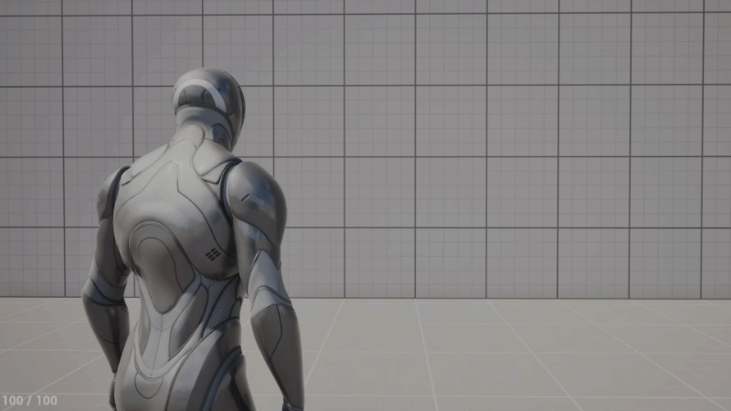
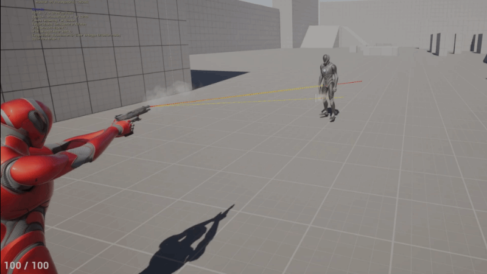
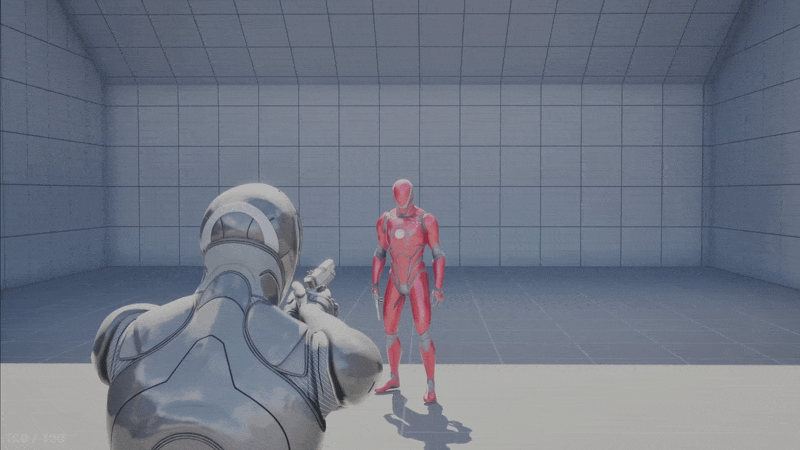
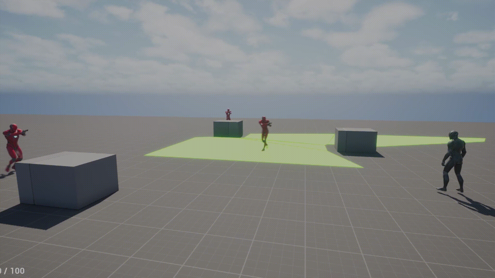
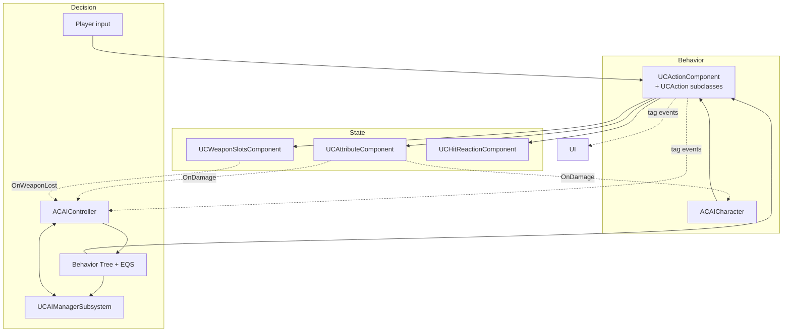
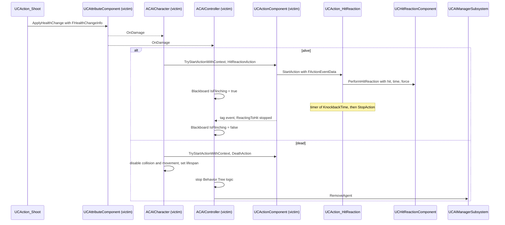
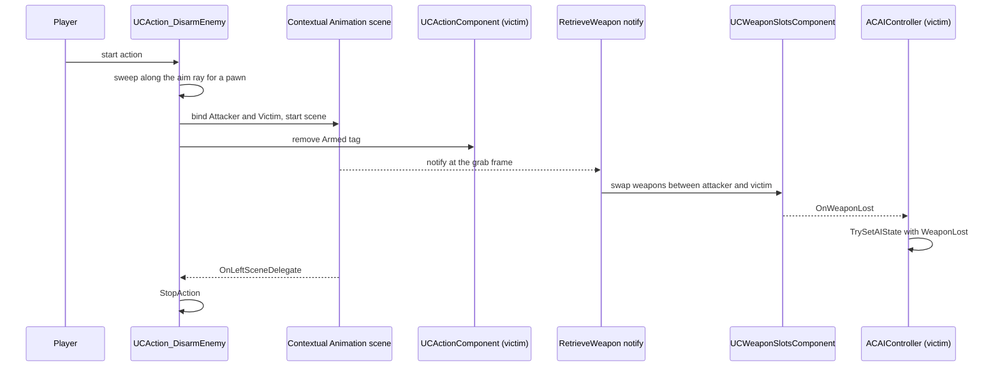

# Clarity

> A third-person shooter vertical slice in Unreal Engine 5 (C++): squad AI, contextual-animation disarm takedowns, and a GAS-inspired action system.


[Gameplay video](https://youtu.be/h4d0k1E8yDU?si=f3z6sPXBCsB33y-Q) · [Architecture](#architecture) · [Code map](#code-map)

## About

Clarity is a solo-built third-person shooter vertical slice in Unreal Engine 5. I started it to learn the engine's C++ layer in depth, so the emphasis is on gameplay architecture rather than content.

The slice includes:
- shooting with ballistics and hit reactions
- squad AI: Behavior Trees, AI Perception, cover rotation
- animation integration: Motion Matching, Contextual Animation, Motion Warping (disarm takedown)
<!-- add profiling later -->

Development of the first vertical slice took about 5 months working part-time.

**My role:** sole developer: gameplay, AI and animation-integration programming, game design.
**Not mine:** animation sequences, the level, and cosmetic assets. See [Credits](#credits--license).

---

### Action System
**How it works**
A GAS-inspired system written from scratch (not a fork of GAS), built by breaking GAS down to understand its trade-offs. Each behavior (shooting, reloading, death, disarm, etc) is a `UCAction` subclass. `UCActionComponent` on the actor owns the actions and runs their lifecycle (`CanStartAction` → `StartAction` → `StopAction`). Actions are gated and cancelled through GameplayTags, and the player and AI use the same system. The component/action split follows the pattern from Tom Looman's Unreal C++ course; i've added gameplay tag registration to implement tags additions/removal delegates, starting action with data-bus, using the InstancedStruct (see [`FActionEventData`](Source/Clarity/Public/ActionSystem/CActionSystemTypes.h) and action cancel by tag).

`CanStartAction` is limited to cheap checks (asset presence, owner state, tags); anything expensive, such as line traces, runs in `StartAction`. Logically, `CanStartAction` is about "can it be checked in the beggining of the action"

**Why this way**
- **Problem:** Player and AI both need to shoot, reload, die and disarm under shared rules about what can run together and what interrupts what. Without a common layer, each behavior would carry its own state flags, and those rules would end up scattered across the codebase. For example, without single point of entry we would have to call the same logic from BTTask and Player's class, which leads to swelling the codebase and adding the probability of code duplication. Moreover, adding it to one system with single flow actions can interrupt each others easily (Reload to Fire, Aim to Run, etc).
- **Alternatives considered:**
  - Behavior logic directly in the character class and components, with state flags: same rules are scattered and duplicated, but not synchronised and some cases would be much harder to implement without the proper flow. Example: resetting actor's state after ending Aim would take another layer of logic instead of simple StopAction().
  - Unreal's Gameplay Ability System: the project is single-player by design, so GAS's prediction and replication give nothing here.
- **Chosen:** a smaller GAS-inspired system, easier to navigate at this project's scale. It keeps tag-based gating and cancellation.
- **Cost / trade-off:**
  - Anything GAS provides that I need, I build and debug myself. Added on demand so far: action ticks, tag notifies.
  - I maintain code that GAS has already proven in shipped games; it would caused a lot of additional work for multiplayer, because the replication is not intendend by design.
  - Upside: each piece I add teaches me how the matching GAS feature works and why.

**Where to look**
1. [`UCActionComponent`](Source/Clarity/Public/ActionSystem/CActionComponent.h) — owns the actions, runs the lifecycle, holds the tag state
2. [`UCAction`](Source/Clarity/Public/ActionSystem/CAction.h) — base class for every behavior
3. [`UCAction_DisarmEnemy`](Source/Clarity/Public/ActionSystem/CAction_DisarmEnemy.h) — the most complex example: Contextual Animation, Motion Warping, time dilation

Used by shooting, reloading, death, disarm, hit reaction, sprint, aim, swap shoulder, zoom camera.

### Shooting & Ballistics



**How it works**
`UCAction_Shoot` is the most representative action: the same code path serves the player and AI. A shot goes through these steps:
1. Cheap checks in `CanStartAction()` (see Action System above).
2. Get the weapon from `WeaponSlotsComponent`.
3. Get the aim origin and direction from the shooter through an interface call. The action never checks who is shooting. The player derives the aim from the crosshair's screen position, AI from calculating normalalized vector from target's location - barrel's location.
4. At the same time, get the shooter's accuracy: always 100 for the player, tunable for AI. Accuracy is later used to set a random chance for miss. The missed shot's angle is calculated from a certain range (range is tweakable), then the scattered direction is calculated using VRandCone, then the end point is calculated using scattered direction and starting point. See more in [`Ballistics class`](Source/Clarity/Private/Weapons/CBallistics.cpp).
5. Crosshair trace: finds the point the shooter is aiming at.
6. Weapon trace: the actual trace, that decides if the bullet has hit the target. Because sometimes crosshair can hit the target, while the weapon is aiming the obstacle.
7. Apply damage: `ProvideDamage()` resolves the hit zone from the bone name, fills the bus (`FHealthChangeInfo`: damage, hit zone, hit result, knockback force and time from the weapon's data) and calls `ApplyHealthChange` on the victim's `UCAttributeComponent`.
8. Add a fire-cooldown tag and start a timer that removes it. While the tag is present, `CanStartAction()` rejects the next shot (blocked tags), which is how the fire rate works. The action itself is instantaneous: it stops at the end of `StartAction`.

Cosmetic methods (recoil, fire animation, etc.) are omitted.

AI shooting example:


**Why this way**
- **Problem:** One fire pipeline for both the player and AI that does not branch on shooter type. In TPS, the camera and the weapon barrel are in different places: as mentioned, barrel sometimes can hit the obstacle, while the shooter's crosshair is on the target. It is especially seen from shooting behind the cover, when the wall is too close.
- **Alternatives considered:**
  - Projectile-based shooting: No gameplay need for projectile, because by design, the hit must be instant and impactful.
  - A single trace (from the camera only, or from the barrel only): 
      1. camera-only: the hit registers even when the barrel is pressed against cover, so the shot passes through the wall (the case described above);
      2. barrel-only: the shot follows the barrel's direction instead of the crosshair, and with the camera offset over the shoulder it lands beside the point the player is aiming at.
- **Chosen:** Hitscan with two traces, crosshair first, then weapon.
- **Cost / trade-off:**
  - In case of adding (for example) grenade launcher, there will be need for projectile-based shooting system. Current implementation supports only hitscan weapons.
  - Two traces per shot instead of one.
  - The weapon trace aims at the crosshair hit point, which lies exactly on a surface. A trace ending exactly on a surface may not register the hit, so the endpoint is extended slightly along the direction.
  - When the crosshair hits nothing (sky, open space), there is no point to aim at.

**Where to look**
1. [`CAction_Shoot`](Source/Clarity/Public/ActionSystem/CAction_Shoot.h) and its `.cpp` (Source/Clarity/Source/Clarity/Private/ActionSystem/CAction_Shoot.cpp): the full pipeline
2. [`CBallistics`](Source/Clarity/Source/Clarity/Private/Weapons/CBallistics.cpp): the pure function that computes the bullet end point
3. [`CShooterInterface`](Source/Clarity/Public/CShooterInterface.h): the shooter interface

### Physics-based Hit Reaction System



**How it works**
On damage, the character starts `UCAction_HitReaction`, passing the hit data (`FHealthChangeInfo`) in the action's event payload. The action calls `UCHitReactionComponent::PerformHitReaction` and owns the reaction's duration: a timer stops the action, and its tag events let the AI controller clear its `IsFlinching` flag. The component itself knows nothing about the Action System or the attribute component.
On a hit, every body except the pelvis starts simulating physics (a partial ragdoll), so the character does not fall over. The component then applies an impulse (force and time arrive in `FHealthChangeInfo`, filled by the shooting action) and gradually returns to the non-ragdoll state. After the reaction is complete, component stops ticking. In case of death, component immediately stops ticking and sets the body to a full ragdoll state.

The core technology is Physical Animation (`UPhysicalAnimationComponent`). It remembers the original animation pose and "relaxes" bodies to a certain extend.

**Why this way**
- **Problem:** Hitscan shooting is instant, so each hit needs visible feedback that varies with the impact point and direction, without an authored animation for every case. Also, damage variation by hit location is not readable visually.
- **Alternatives considered:**
  - Authored hit animations: they need an animator or animation skills, and a set of 4–6 clips visibly repeats.
  - Full ragdoll on every hit: the character loses its animation pose, would need recovery logic, and would break the Behavior Tree flow. It is reserved for death.
- **Chosen:** A partial ragdoll driven by Physical Animation with a dedicated profile.
- **Cost / trade-off:**
  - The reaction is hardly predictable and can sometimes look messy (unlike prebuilt ones).
  - Due to PAC's specifics, sometimes the reaction can look a little strange as it is "relaxes" multiple bodies at once.
  - Engine lessons, root causes of the worst bugs: 
      1. **Render vs. physics transform divergence.** `GetBoneLocation` returns the render (blended) transform, while the Chaos body diverges from it during physical animation blending - up to ~40 units at peak for a head hit. Traces query the physics scene (real body position), not the render position, so they missed the body the player was aiming at. Fix:  due to floating point precision WeaponEnd can be coincided exactly with the surface point from CrosshairHitResult, so I had to addjust the hit vector with a small number (see [`CBallistics`](Source/Clarity/Source/Clarity/Private/Weapons/CBallistics.cpp) for more)
      2. **PAC assumes it is always on.** UPhysicalAnimationComponent::UpdateTargetActors is called not only from its own tick but also synchronously from OnTeleport, which fires inside SetAllBodiesBelowSimulatePhysics whenever the physics state is recreated. Dynamically toggling simulation while DriveData was populated caused LocalTransforms[BoneIndex] out-of-bounds crashes - timing-dependent at first, then deterministic when multiple bots were active. Fix: PAC and physics simulation are initialized once in BeginPlay and left permanently active; the reaction is controlled entirely by blend weight, so SetAllBodiesBelowSimulatePhysics is never called at runtime.

**Where to look**
1. [`CHitReactionComponent`](Source/Clarity/Public/CHitReactionComponent.h) and its [`.cpp`](Source/Clarity/Private/CHitReactionComponent.cpp)

### AI System



**How it works**
Enemy squads run on Behavior Trees and EQS, split across three layers:

| Layer | Class | Decides |
|-------|-------|---------|
| Agent | `ACAIController` | Perception, detection level, the agent's own `AIState` / `CombatState`; reports detection to the Manager |
| Squad | `UCAIManagerSubsystem` | Squad-wide state changes, the combat loop and cover-fire requests |
| Behavior | Behavior Tree + EQS | How each state is executed: movement, cover selection, shooting, etc |

Each agent has a role (`Defender` or `Engager`) that selects its Behavior Tree branch. A new role needs a new `ECCombatRole` value. The squad manager runs a combat loop on a 1-second timer over the `Defender`s and requests covering fire from a Defender holding cover (`RequestCoverFire`), for example while another one reloads or approaches cover.

Two enums drive the logic. `AIState` is the overall mode (`Idle`, `Investigate`, `Attack`, `Search`, `LostEnemy`, `WeaponLost`). It is written through `TrySetAIState`, which accepts a new state only if its priority is equal to or higher than the current one (the enum's integer value is the priority, lower value = higher priority), so lower-priority systems cannot overwrite a more important state. `CombatState` is the sub-mode inside combat (ex. `ApproachingCover`, `HoldCover`, `NeedToReload`).

Detection is gradual. While an agent has a hostile in sight, a timer raises its detection level step by step: at half of the threshold it switches to `Investigate` (moving to the last seen position), at the full threshold it reports to the manager, which switches the whole squad to `Attack` and starts the combat loop. Only the state is broadcast, not the target. See [`UCAIManagerSubsystem::RunCombatLoop()`](Source/Clarity/Private/AI/CAIManagerSubsystem.cpp) for the commented breakdown of the loop.

Full behavior cycles for both roles: [docs/AI.md](docs/AI.md).

**Why this way**

*Decision 1: a central squad manager*
- **Problem:** Squad tactics need a decision that spans several agents. Each agent's Behavior Tree sees only its own agent, so it can not know who is moving and who is holding.
- **Alternatives considered:**
  - Fully autonomous agents: each decides alone. To coordinate they would have to read each other's state, and nothing prevents all Defenders from (for example) advancing at once.
  - Token-based coordination: agents request permission aka "tokens" to advance or fire. It is distributed (like in DOOM or my previous project Cutting Edge), but the tokens still come from a shared pool, and someone has to decide who gets them.
- **Chosen:** A world subsystem that keeps the agents of one faction (`ManagerFaction`). It broadcasts `AIState`, runs the combat loop on a 1-second timer, and assigns cover fire.
- **Cost / trade-off:**
  - Agents are registered once, in `OnWorldBeginPlay`, so enemies spawned later are not managed.
  - The manager holds references to agents it does not own, so every death or despawn path must unregister them by hand (`RemoveAgent`).
  - It depends on concrete types (`ACAIController`, `ACAICharacter`), so it works only with this AI stack.
  - See [Limitations](#limitations--roadmap) for the known issues around this.

*Decision 2: priority arbitration for `AIState`*
- **Problem:** Several systems write `AIState` at once: perception, the squad manager, Behavior Tree tasks and weapon events. Without a rule, whichever write comes last wins, even if it is the less important one.
- **Alternatives considered:**
  - Free writes with a guard at each call site (like `OnPerception` does with an early return while attacking): the rule is duplicated, and a missed guard can become a problem.
  - An explicit state machine with a table of allowed transitions: it expresses legality, not just priority, but the table has to be maintained.
- **Chosen:** One setter, `TrySetAIState`, that compares priorities and rejects lower-priority writes. The priority is the enum's integer value.
- **Cost / trade-off:**
  - The priority is implicit in the enum order, so reordering the enum silently changes the behavior.
  - A priority check says who wins, not which transitions are legal. A write that moves to a lower-priority state (such as `Idle` after a search) is rejected by the check by definition, so such transitions need a separate path: by bypassing the method and changing the state directly.

**Where to look**
1. [`ACAIController`](Source/Clarity/Private/AI/CAIController.cpp): perception, detection, `TrySetAIState`
2. [`UCAIManagerSubsystem`](Source/Clarity/Private/AI/CAIManagerSubsystem.cpp): combat loop, cover-fire requests
3. [`UCBTTask_Reload`](Source/Clarity/Private/AI/CBTTask_Reload.cpp): event-driven latent task with subscribe/unsubscribe

### Weapon System & Data-Driven Design


**How it works**
Weapons are Blueprint children of [`ACWeaponBase`](Source/Clarity/Public/Weapons/CWeaponBase.h), which owns the ammo state and the common structure (mesh, barrel socket). A weapon's characteristics (e.g. magazine size, hit impulse) live in a [`UCWeaponData`](Source/Clarity/Public/Weapons/CWeaponData.h) DataAsset assigned in the weapon's Blueprint.

[`UCWeaponSlotsComponent`](Source/Clarity/Public/Weapons/CWeaponSlotsComponent.h) manages an actor's arsenal: spawning the default weapon, equipping, switching and losing weapons. It publishes `OnWeaponLost`; the AI controller subscribes to it and switches the agent to the `WeaponLost` state.

Adding a weapon variant:
1. Create a Blueprint child of `ACWeaponBase` (mesh, barrel socket)
2. Create a `UCWeaponData` asset
3. Fill it in and assign it to the Blueprint
4. ???
5. PROFIT

**Why this way**

*Decision 1: weapons as actors owned by a slots component*
- **Problem:** Both the player and enemies carry weapons, and the disarm mechanic moves a weapon from one character to another.
- **Alternatives considered:** Weapon state and logic inside the character class. Ammo, the current weapon and switching would be duplicated in the player and AI classes, or pushed into a base class that grows with every feature. A disarm would have to move several fields between two characters.
- **Chosen:** The weapon actor holds ammo, mesh and data; the slots component on the character holds the arsenal.
- **Cost / trade-off:** A weapon is a spawned, attached actor, so ownership and attachment must be tracked explicitly (equip, lose, swap). For a single pistol that is more machinery than a few fields on the character; it pays off because the second case (AI, disarm) already exists.

*Decision 2: weapon numbers in a DataAsset, skeleton-dependent animation outside it*
- **Problem:** Several systems read the same weapon numbers (shooting, the AI's ammo checks, the hit-reaction impulse), and they should be tunable without code changes. Montages, however, are skeleton-specific to make the data compatable with any skeleton.
- **Alternatives considered:**
  - Rows in a `UDataTable`: suited to many similar entries edited as a sheet; here every weapon is a distinct asset referenced directly from its BP.
  - Montages stored in `WeaponData`: this ties the weapon asset to one skeleton, so each character type would need its own copy of every weapon asset.
- **Chosen:** `UCWeaponData` for the numbers. Montages are resolved through an `EWeaponAnimCategory` on the weapon and a per-character `UCCharacterAnimSet` DataAsset.
- **Cost / trade-off:**
  - A weapon needs two assets (Blueprint and data). A missing reference is a content error that shows up at runtime (`ensureMsgf`), not at compile time.
  - One more asset per character type, and a category that has to be kept in sync.

**Where to look**
1. [`ACWeaponBase`](Source/Clarity/Public/Weapons/CWeaponBase.h): ammo state and structure
2. [`UCWeaponSlotsComponent`](Source/Clarity/Public/Weapons/CWeaponSlotsComponent.h): arsenal, `OnWeaponLost`
3. [`UCWeaponData`](Source/Clarity/Public/Weapons/CWeaponData.h): the data asset
4. [`UCWeaponAnimData`](Source/Clarity/Public/Weapons/CWeaponAnimData.h): per-character montage mapping

### Disarm (Contextual Animation)


**How it works**
While the player has no weapon, they can get close to an armed enemy and take theirs.

`UCAction_DisarmEnemy` is a regular Action. On start it sweeps a capsule along the player's aim ray (up to `MaxRange`, pawns only). If it finds a target, it binds the two characters to the `Attacker` and `Victim` roles of a Contextual Animation scene asset and starts the scene. It also removes the `Armed` tag from the victim right away, so actions that require it (e.g Aim) can no longer start. The action stays active until the scene ends: `OnLeftSceneDelegate` stops it.

A custom notify in the animation, [`CAnimNotify_RetrieveWeapon`](Source/Clarity/Private/Notifies/CAnimNotify_RetrieveWeapon.cpp), tells `UCWeaponSlotsComponent` to swap the weapons between the two characters at the grab frame. The victim's slots component publishes `OnWeaponLost`, and its AI controller switches to `WeaponLost`, which outranks `Attack` in the `AIState` priority order. The slots component only publishes the event; it does not call into AI.

The alignment of the two characters is configured in the scene asset, not in code.

**Why this way**
- **Problem:** A takedown that involves two characters needs their animations, positions and the weapon hand-off to stay in sync. Two independent montages play wherever the characters happen to stand, and nothing aligns them to each other.
- **Alternatives considered:**
  - Two independent montages started at the same time: no shared alignment, no guarantee that the characters face each other at the right distance.
  - Swapping the weapon on a timer instead of a notify: the timing has to be tuned by hand and breaks whenever the animation or its play rate changes.
- **Chosen:** CAS for the paired animation, and a custom notify for the weapon swap.
- **Cost / trade-off:**
  - The swap timing lives inside the animation asset (the notify), so changing the animation means re-placing the notify.
  - The notify resolves the participants with `FindBindingByRole` and a few casts. It has not been profiled: the action fires rarely, so it is not worth optimizing now.

**Where to look**
1. [`UCAction_DisarmEnemy`](Source/Clarity/Public/ActionSystem/CAction_DisarmEnemy.h) and its [`.cpp`](Source/Clarity/Private/ActionSystem/CAction_DisarmEnemy.cpp): the action
2. [`CAnimNotify_RetrieveWeapon`](Source/Clarity/Private/Notifies/CAnimNotify_RetrieveWeapon.cpp): the weapon swap

### Smart object


**How it works**
Inspired by the GDC 2015 talk [*Remember to Relax! Realizing Relaxed Behaviors in AAA Games*](https://www.gdcvault.com/play/1022230/Remember-to-Relax-Realizing-Relaxed), which is about non-combat behavior. In this project that is the part of the Behavior Tree that runs while an agent is in `Idle`.

A smart object ([`ACSmartObject`](Source/Clarity/Public/SmartObjects/CSmartObject.h)) is an actor placed in the level that carries a Behavior Subtree  describing what an agent does with it. An AI references its smart object; when the controller begins play, it sets the `HasSmartObject` Blackboard key and injects the `SubTree` into the Idle branch with `SetDynamicSubtree`. Without a smart object, the Idle branch does nothing but plays the idle animation. A designer adds a new idle behavior by deriving from `ACSmartObject` and authoring a subtree, without touching the shared Behavior Tree.

The only type so far is [`ACSmartObject_PatrolPath`](Source/Clarity/Public/SmartObjects/CSmartObject_PatrolPath.h): a wrapper around a spline that caches its points at `BeginPlay`. Its subtree uses [`UCBTTask_GetPathPoints`](Source/Clarity/Private/AI/CBTTask_GetPathPoints.cpp), which writes the next point as the move target and loops back to the first one at the end.

**Why this way**
- **Problem:** Idle behavior should differ from agent to agent (patrol, standing, interacting with a prop), and a designer should be able to add a variant without editing the shared Behavior Tree.
- **Alternatives considered:**
  - More branches and subtrees in the shared Behavior Tree: it swells with optional logic, and the tree needs extra logic to recognize the context and choose a branch.
  - A separate Behavior Tree per idle variant (a character already selects its own tree): the shared combat logic would be duplicated or have to be extracted into a subtree anyway.
  - Unreal's built-in Smart Objects (slot claims, gameplay behaviors): more machinery than one idle behavior per agent needs.
- **Chosen:** A lightweight custom smart object that carries its own subtree, injected into the Idle branch.
- **Cost / trade-off:**
  - Binding happens once, at `BeginPlay`: an agent cannot acquire or switch a smart object at runtime, and the patrol path is a snapshot of the spline at that moment.
  - The contract between an object and its subtree is implicit: `GetPathPoints` casts to the concrete `ACSmartObject_PatrolPath` and writes a shared Blackboard key (`MoveToLocation`), and nothing enforces either. A new object type needs its own subtree and tasks.

**Where to look**
1. [`ACSmartObject`](Source/Clarity/Public/SmartObjects/CSmartObject.h) and [`ACSmartObject_PatrolPath`](Source/Clarity/Public/SmartObjects/CSmartObject_PatrolPath.h)
2. [`ACAIController::BeginPlay`](Source/Clarity/Private/AI/CAIController.cpp): where the subtree is injected
3. [`UCBTTask_GetPathPoints`](Source/Clarity/Private/AI/CBTTask_GetPathPoints.cpp)

### Cover System


**How it works**
Cover is a placed actor ([`ACCoverActor`](Source/Clarity/Public/SmartObjects/CCoverActor.h)): a trigger volume plus arrow components that mark usable positions (`CoverSpots`, collected at `BeginPlay`). Using cover takes four steps:

1. **Select.** [`UCBTTask_SelectCover`](Source/Clarity/Private/AI/CBTTask_SelectCover.cpp) runs an EQS query for candidate covers and picks the best-scoring free one that passes a mode-specific filter (`Approach`, `Reposition`, `Retreat`). The filter uses *directness*, `(agent→target - cover→target) / agent→cover`: positive means the cover is closer to the target than the agent is. `Approach` requires directness above `DesiredDirectness` and a cover at least `DesiredDistance` from the target; `Retreat` requires the opposite sign. The measure comes from the tactical position selection chapter in *Game AI Pro* (M. Jack).
2. **Reserve.** The chosen cover is written to the Blackboard (`CoverActor`) and marked as taken by this agent; the cover it held before is released.
3. **Pick a spot.** [`UCBTTask_GetCoverSpot`](Source/Clarity/Private/AI/CBTTask_GetCoverSpot.cpp) takes the first spot whose facing is within `DesiredAngleToTarget` (45 by default) of the direction to the target and sets it as the move target.
4. **Occupy and release.** AI character entering the trigger marks the cover as occupied, leaving the trigger frees it.

The squad manager does not use cover actors. It coordinates through the combat state (`HoldCover`, `ApproachingCover`) that this system produces (see the AI System section).

**Why this way**
- **Problem:** Tactical AI has to choose cover relative to the target, and two agents must not pick the same one.
- **Alternatives considered:**
  - Cover points generated at runtime from level geometry (EQS grid + traces): no manual placement, but the points have no authored facing, and quality depends on trace heuristics.
  - Authored cover without EQS ranking (nearest free cover): ignores where the target is.
- **Chosen:** Hand-placed cover actors, ranked by EQS and filtered by directness, with a reservation on selection.
- **Cost / trade-off:**
  - Cover has to be placed by hand for every level layout.
  - Occupancy is stored in two fields (`bIsCoverAvailable`, `CurrentCharacter`) written from two places: the AI task (reservation on selection) and the trigger's overlap events (occupation and release). Any AI character that enters a free cover's trigger takes it until it leaves.
  - Occupancy depends on the collision and overlap setup rather than on the agent's intent.

**Where to look**
1. [`ACCoverActor`](Source/Clarity/Public/SmartObjects/CCoverActor.h): trigger, spots, occupancy
2. [`UCBTTask_SelectCover`](Source/Clarity/Private/AI/CBTTask_SelectCover.cpp): selection, directness, reservation
3. [`UCBTTask_GetCoverSpot`](Source/Clarity/Private/AI/CBTTask_GetCoverSpot.cpp): spot choice


---

## Architecture

### Overview



Input and AI decide what to do, Actions execute it, and components hold state and publish events. AI and UI subscribe to those events; components never call into them.

### Flow: weapon shot



One shot reaches three systems (the Action System, AI and physics), and the attribute component knows none of its subscribers.

### Flow: disarm



### Cross-cutting principles

1. **Dependencies point down, events go up.** Components publish and AI and UI subscribe, so components never call into AI or UI. Applied in: `OnDamage`, `OnWeaponLost`, tag events.
2. **Behavior is addressed by tag, not by class.** Gating, cancellation and BT tasks (`ReloadAction`, `FireAction`) all use `StartActionByTag` and tag checks. Applied in: Action System, AI tasks.
3. **Subscribe first, then sync.** Where the order of subscriber and publisher initialization is not guaranteed, a subscriber hooks the delegate first and then reads the current state. Applied in: weapon equip, health, AI state, UI.
4. **Each piece of state has one owner.** The Blackboard owns AI state, and the tag containers on `UCActionComponent` own action state. Known exceptions are listed in [Limitations](#limitations--roadmap).
5. **Abstract on the second case.** Applied in: component design, delegate registries, DataAsset abstractions.

---

## Limitations & Roadmap

**Known issues**

*Known: observed or marked in code. Suspected: found in code review, but not reproduced yet.*

| Issue | Impact | Status | Plan |
|-------|--------|--------|------|
| **Squad manager:** agents register once, at world start (`OnWorldBeginPlay`) | Enemies spawned later are not coordinated; `UCBTTask_Reload` uses the manager without a null check | Known | Register agents when the controller possesses a pawn |
| **Squad manager:** `RemoveAgent` tests the result of `Find()` as a bool (index 0 reads as false); combat-loop indices are not re-validated after a removal | The first Defender can stay in the list after death; possible out-of-range access in the combat loop | Suspected | Compare with `INDEX_NONE`; clamp `ApproacherIndex`; validate `AgentProvidingCoverFire` |
| **Squad manager:** `ApproacherIndex` advances only when the current candidate is not holding cover | Observed: the index stayed at 0 for a whole session, so with the first Defender in cover the rotation never moves on | Known | Advance the index regardless of the candidate's state, or pick the first Defender not in `HoldCover` |
| **EQS tasks:** `SelectCombatTarget` clears the target when a query returns no candidate | Observed: no target for about 4 frames after a single empty result, around the time of a rejected `LostEnemy` attempt | Known | Keep the previous target for a short grace period |
| **EQS tasks:** `SelectCombatTarget`, `SelectCover` and `FindStrafeLocation` return `Succeeded` before the query callback runs | A following node may read a stale Blackboard value | Suspected | Make the tasks latent (return `InProgress`, finish in the callback) |
| **Behavior Tree:** nine nodes use per-instance nodes (`bCreateNodeInstance`) instead of node memory; Blackboard keys are string literals | More memory per agent; a typo in a key fails silently | Known (TODOs in code) | Migrate to node memory; a central key namespace like `CGameplayTags` |
| **State ownership:** `Armed` is added by hand for AI in `ACAICharacter::Initialize` (marked TODO) and removed by hand on disarm; crouching is stored twice (`AnimState` and the `Crouching` tag) | The state can diverge from the actual one; exceptions to the "one owner" principle | Known | Derive `Armed` from slot events (equip, lose); one owner for crouching |
| **Minor:** the detection timer's interval changes apply only when the timer restarts; `SelectCover` in `Reposition` mode checks the score outside the loop; dead code (`CanBeSeenFrom`, an empty BT service); `LogTemp` in many places; the bullet trace channel is hard-coded | Cosmetic or edge cases | Known | Clean up after the first release |

**Not implemented**
- Finishers (cut to keep the focus on AI).
- Slow motion during disarm: implemented (`UCTimeDilationSubsystem`), disabled by default because the animation is too short for it to look right.
- Projectile weapons: shooting is hitscan only.
- Idle behaviors beyond patrolling: `ACSmartObject_PatrolPath` is the only smart object type so far.
- More gun variants than the pistol.
- Flanker enemy variant
- Tank enemy variant

**Out of scope by design**
- Multiplayer and replication: the Action System is single-player by design, with no prediction or replication.

**Roadmap**
- AI decision-making and agressiveness improvement
- Improvement of the `Engager` combat role
- Finishers
- Fallback behaviors for agents that find no cover.
- Crosshair feedback when aiming at an enemy (driven by the existing tag events).

---

## Code map

```
Source/Clarity/
├── Public/, Private/    headers and implementations, the folders below exist in both
├── ActionSystem/        UCActionComponent, UCAction and its subclasses (shoot, reload, aim, disarm, hit reaction, death, camera), event payload types
├── AI/                  controller, character, squad manager subsystem, Behavior Tree tasks, services and decorators
├── SmartObjects/        smart objects (patrol path) and cover actors
├── Weapons/             ACWeaponBase, UCWeaponSlotsComponent, UCWeaponData, ballistics
├── Notifies/            custom animation notifies (weapon swap on disarm)
├── Subsystems/          UCTimeDilationSubsystem
└── (root)               attributes, hit reactions, gameplay tags, shooter interface, base character, player character, game mode and anim instance
```

**Start reading here**
1. [`UCActionComponent`](Source/Clarity/Public/ActionSystem/CActionComponent.h): the hub. Owns the actions, gates and cancels them by tags, publishes tag events
2. [`UCAction`](Source/Clarity/Public/ActionSystem/CAction.h): the base lifecycle that every behavior shares
3. [`UCAction_Shoot`](Source/Clarity/Private/ActionSystem/CAction_Shoot.cpp): the most representative action, one code path for the player and AI
4. [`UCAction_HitReaction`](Source/Clarity/Private/ActionSystem/CAction_HitReaction.cpp): a small adapter between the event payload and a component
5. [`ACAIController`](Source/Clarity/Private/AI/CAIController.cpp): perception, detection and `AIState` arbitration
6. [`UCBTTask_Reload`](Source/Clarity/Private/AI/CBTTask_Reload.cpp): an event-driven latent Behavior Tree task
7. [`UCAction_DisarmEnemy`](Source/Clarity/Private/ActionSystem/CAction_DisarmEnemy.cpp): where Contextual Animation, weapon slots and AI meet

**Naming conventions:** project classes carry a `C` after the Unreal prefix (`UCActionComponent`, `ACAIController`, `ECAIState`), and file names drop the Unreal prefix (`CActionComponent.h`). Gameplay tags live in the `CGameplayTags` namespace. Blueprints use `BP_`, animation Blueprints `ABP_`. Log categories: `LogClarity`, `LogClarityAI`. Backlog markers in code: `/// \TODO`, `/// \NOTE`, `/// \WARNING`.

---

<!-- 
## Build from source

**Prerequisites:** TODO: версия UE, VS + workload, ОС 
-->

**Not included in this repository:** big size assets, such as models, animations, vfx and enivornment.

---

## Credits & License

| Asset / Source | Author | Used for | License / Link |
|----------------|--------|----------|----------------|
| Paragon Twinblast | Epic Games | Player's model | https://fab.com/s/444493e3d01b |
| Lyra Starter Game | Epic Games | Some of the animations | https://fab.com/s/3fe3f994dd6d |
| GunfFu Pistol Attacks | RamsterZ| Disarm animation | https://fab.com/s/050531c4c1f0 |
| Level | My mate Den | Level (design and actual placement) | https://t.me/@GoodWaffl511 |

**Code license:** MIT

---

## Contact

Name's Artem, and I'm looking for a job in programming! Feel free to contact any time

LinkedIn: [link](https://www.linkedin.com/in/artem-demchenko-096a67294)

Telegram: [t.me](https://t.me/o4thbreaker)

CV: TBA

Email: 04thbreaker@gmail.com