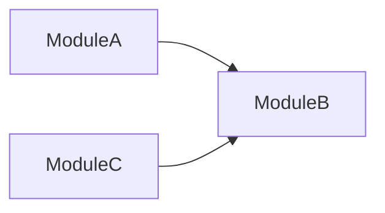
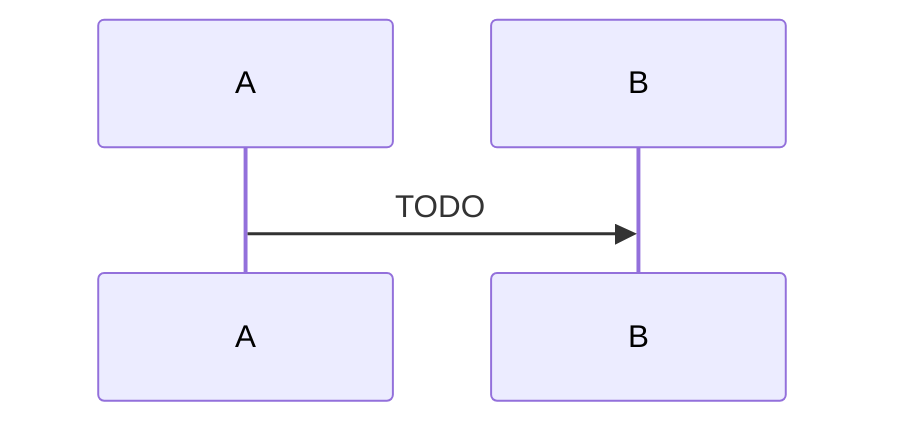

# Clarity

> A third-person shooter vertical slice in Unreal Engine 5 (C++): squad AI, contextual-animation disarm takedowns, and a GAS-inspired action system.


[Gameplay video](https://youtu.be/h4d0k1E8yDU?si=f3z6sPXBCsB33y-Q) · [Architecture](#architecture) · [Code map](#code-map)

## About

Clarity is a solo-built third-person shooter vertical slice in Unreal Engine 5. I started it to learn the engine's C++ layer in depth, so the emphasis is on gameplay architecture rather than content.

The slice includes:
- shooting with ballistics and hit reactions
- squad AI: Behavior Trees, AI Perception, cover rotation
- animation integration: Motion Matching, Contextual Animation, Motion Warping (disarm takedown)
<!-- add profiling later -->

It took about 5 months working part-time.

**My role:** sole developer: gameplay, AI and animation-integration programming, game design.
**Not mine:** animation sequences, the level, and cosmetic assets. See [Credits](#credits--license).

---

### Action System


**How it works**
A GAS-inspired system written from scratch (not a fork of GAS), built by breaking GAS down to understand its trade-offs. Each behavior (shooting, reloading, death, disarm, etc) is a `UCAction` subclass. `UCActionComponent` on the actor owns the actions and runs their lifecycle (`CanStartAction` → `StartAction` → `StopAction`). Actions are gated and cancelled through GameplayTags, and the player and AI use the same system. The component/action split follows the pattern from Tom Looman's Unreal C++ course; i've added gameplay tag registration to implement tags additions/removal delegates, starting action with data-bus, using the InstancedStruct (see [`FActionEventData`](Source/Clarity/Public/ActionSystem/CActionSystemTypes.h) and action cancel by tag).

`CanStartAction` is limited to cheap checks (asset presence, owner state, tags); anything expensive, such as line traces, runs in `StartAction`. ███[4]

**Why this way**
- **Problem:** Player and AI both need to shoot, reload, die and disarm under shared rules about what can run together and what interrupts what. Without a common layer, each behavior would carry its own state flags, and those rules would end up scattered across the codebase. For example, without single point of entry we would have to call the same logic from BTTask and Player's class, which leads to swelling the codebase and adding the probability of code duplication. Moreover, adding it to one system with single flow actions can interrupt each others easily (Reload to Fire, Aim to Run, etc).
- **Alternatives considered:**
  - Behavior logic directly in the character class and components, with state flags: same rules are scattered and duplicated, but not synchronised and some cases would be much harder to implement without the proper flow. Example: resetting actor's state after ending Aim would take another layer of logic instead of simple StopAction().
  - Unreal's Gameplay Ability System: the project is single-player by design, so GAS's prediction and replication give nothing here; ███[7]
- **Chosen:** a smaller GAS-inspired system, easier to navigate at this project's scale. It keeps tag-based gating and cancellation.
- **Cost / trade-off:**
  - Anything GAS provides that I need, I build and debug myself. Added on demand so far: action ticks, tag notifies.
  - I maintain code that GAS has already proven in shipped games; it would caused a lot of additional work for multiplayer, because the replication is not intendend by design.
  - Upside: each piece I add teaches me how the matching GAS feature works and why.

**Where to look**
1. [`UCActionComponent`](Source/Clarity/Public/ActionSystem/CActionComponent.h) — owns the actions, runs the lifecycle, holds the tag state
2. [`UCAction`](Source/Clarity/Public/ActionSystem/CAction.h) — base class for every behavior
3. [`UCAction_DisarmEnemy`](Source/Clarity/Public/ActionSystem/CAction_DisarmEnemy.h) — the most complex example: Contextual Animation, Motion Warping, time dilation

Used by shooting, reloading, death, disarm, hit reaction, sprint, aim, swap shoulder, zoom camera.

### Shooting & Ballistics


**How it works**
`UCAction_Shoot` is the most representative action: the same code path serves the player and AI. A shot goes through these steps:
1. Cheap checks in `CanStartAction()` (see Action System above).
2. Get the weapon from `WeaponSlotsComponent`.
3. Get the aim origin and direction from the shooter through an interface call. The action never checks who is shooting. The player derives the aim from the crosshair's screen position, AI from calculating normalalized vector from target's location - barrel's location.
4. At the same time, get the shooter's accuracy: always 100 for the player, tunable for AI. Accuracy is later used to set a random chance for miss. The missed shot's angle is calculated from a certain range (range is tweakable), then the scattered direction is calculated using VRandCone, then the end point is calculated using scattered direction and starting point. See more in [`Ballistics class`](Source/Clarity/Private/Weapons/CBallistics.cpp).
5. Crosshair trace: finds the point the shooter is aiming at.
6. Weapon trace: the actual trace, that decides if the bullet has hit the target. Because sometimes crosshair can hit the target, while the weapon is aiming the obstacle.
7. Apply damage through `AttributesComponent`. The Shoot Action fills the bus (`FHealthChangeInfo`) and calls the `ApplyHealthChange` method from owner's attribute component. See `ProvideDamage()` in `UCAction_Shoot`.
8. Add a fire-cooldown tag. While it is present, `CanStartAction()` rejects the next shot, which is how the fire rate works.

Cosmetic methods (recoil, fire animation, etc.) are omitted.

**Why this way**
- **Problem:** One fire pipeline for both the player and AI that does not branch on shooter type. In TPS, the camera and the weapon barrel are in different places: as mentioned, barrel sometimes can hit the obstacle, while the shooter's crosshair is on the target. It is especially seen from shooting behind the cover, when the wall is too close.
- **Alternatives considered:**
  - Projectile-based shooting: No gameplay need for projectile, because by design, the hit must be instant and impactful.
  - A single trace (from the camera only, or from the barrel only): 
      1. camera-only: the hit registers even when the barrel is pressed against cover, so the shot passes through the wall (the case described above);
      2. barrel-only: the shot follows the barrel's direction instead of the crosshair, and with the camera offset over the shoulder it lands beside the point the player is aiming at.
- **Chosen:** Hitscan with two traces, crosshair first, then weapon.
- **Cost / trade-off:**
  - In case of adding (for example) grenade launcher, there will be need for projectile-based shooting system. Current implementation supports only hitscan weapons.
  - Two traces per shot instead of one.
  - The weapon trace aims at the crosshair hit point, which lies exactly on a surface. A trace ending exactly on a surface may not register the hit, so the endpoint is extended slightly along the direction.
  - When the crosshair hits nothing (sky, open space), there is no point to aim at.

**Where to look**
1. [`CAction_Shoot`](Source/Clarity/Public/ActionSystem/CAction_Shoot.h) and its `.cpp` (Source/Clarity/Source/Clarity/Private/ActionSystem/CAction_Shoot.cpp): the full pipeline
2. [`CBallistics`](Source/Clarity/Source/Clarity/Private/Weapons/CBallistics.cpp): the pure function that computes the bullet end point
3. [`CShooterInterface`](Source/Clarity/Public/CShooterInterface.h): the shooter interface

### Physics-based Hit Reaction System


**How it works**
`CHitReactionComponent` is subscribed to `CAttributeComponent`'s OnDamage delegate. On a hit, every body except the pelvis starts simulating physics (a partial ragdoll), so the character does not fall over. The component then applies an impulse from the hit (tunable: from the WeaponData) and gradually returns to the non-ragdoll state. After the reaction is complete, component stops ticking. In case of death, component immediately stops ticking and sets the body to a full ragdoll state.

The core technology is Physical Animation (`UPhysicalAnimationComponent`). It remembers the original animation pose and "relaxes" bodies to a certain extend.

**Why this way**
- **Problem:** Hitscan shooting is instant, so each hit needs visible feedback that varies with the impact point and direction, without an authored animation for every case. Also, damage variation by hit location is not readable visually.
- **Alternatives considered:**
  - Authored hit animations: they need an animator or animation skills, and a set of 4–6 clips visibly repeats.
  - Full ragdoll on every hit: the character loses its animation pose, would need recovery logic, and would break the Behavior Tree flow. It is reserved for death.
- **Chosen:** A partial ragdoll driven by Physical Animation with a dedicated profile.
- **Cost / trade-off:**
  - The reaction is hardly predictable and can sometimes look messy (unlike prebuilt ones).
  - Due to PAC's specifics, sometimes the reaction can look a little strange as it is "relaxes" multiple bodies at once.
  - Engine lessons, root causes of the worst bugs: 
      1. **Render vs. physics transform divergence.** `GetBoneLocation` returns the render (blended) transform, while the Chaos body diverges from it during physical animation blending - up to ~40 units at peak for a head hit. Traces query the physics scene (real body position), not the render position, so they missed the body the player was aiming at. Fix:  due to floating point precision WeaponEnd can be coincided exactly with the surface point from CrosshairHitResult, so I had to addjust the hit vector with a small number (see [`CBallistics`](Source/Clarity/Source/Clarity/Private/Weapons/CBallistics.cpp) for more)
      2. **PAC assumes it is always on.** UPhysicalAnimationComponent::UpdateTargetActors is called not only from its own tick but also synchronously from OnTeleport, which fires inside SetAllBodiesBelowSimulatePhysics whenever the physics state is recreated. Dynamically toggling simulation while DriveData was populated caused LocalTransforms[BoneIndex] out-of-bounds crashes - timing-dependent at first, then deterministic when multiple bots were active. Fix: PAC and physics simulation are initialized once in BeginPlay and left permanently active; the reaction is controlled entirely by blend weight, so SetAllBodiesBelowSimulatePhysics is never called at runtime.

**Where to look**
1. [`CHitReactionComponent`](Source/Clarity/Public/CHitReactionComponent.h) and its `.cpp`(Source/Clarity/Private/CHitReactionComponent.cpp)

### AI System


**How it works**
Enemy squads run on Behavior Trees and EQS, split across three layers:

| Layer | Class | Decides |
|-------|-------|---------|
| Agent | `ACAIController` | Perception, detection level, the agent's own `AIState` / `CombatState`; reports detection to the Manager |
| Squad | `UCAIManagerSubsystem` | Squad-wide state changes, the combat loop and cover-fire requests |
| Behavior | Behavior Tree + EQS | How each state is executed: movement, cover selection, shooting, etc |

Each agent has a role (`Defender` or `Engager`) that selects its Behavior Tree branch. A new role needs a new `ECCombatRole` value. The squad manager coordinates `Defender`s only, using a fire-and-maneuver pattern: on a 1-second timer it sends a Defender that is not yet in cover to approach one, and asks a Defender already holding cover to fire in the meantime.

Two enums drive the logic. `AIState` is the overall mode (`Idle`, `Investigate`, `Attack`, `Search`, `LostEnemy`, `WeaponLost`). It is written through `TrySetAIState`, which accepts a new state only if its priority is equal to or higher than the current one (the enum's integer value is the priority, lower value = higher priority), so lower-priority systems cannot overwrite a more important state. `CombatState` is the sub-mode inside combat (ex. `ApproachingCover`, `HoldCover`, `NeedToReload`).

Detection is gradual. While an agent has a hostile in sight, a timer raises its detection level step by step: at half of the threshold it switches to `Investigate` (moving to the last seen position), at the full threshold it reports to the manager, which switches the whole squad to `Attack` and starts the combat loop. Only the state is broadcast, not the target. See [`UCAIManagerSubsystem::RunCombatLoop()`](Source/Clarity/Private/AI/CAIManagerSubsystem.cpp) for the commented breakdown of the loop.

Full behavior cycles for both roles: [docs/AI.md](docs/AI.md).

**Why this way**

*Decision 1: a central squad manager*
- **Problem:** Squad tactics need a decision that spans several agents. Each agent's Behavior Tree sees only its own agent, so it can not know who is moving and who is holding.
- **Alternatives considered:**
  - Fully autonomous agents: each decides alone. To coordinate they would have to read each other's state, and nothing prevents all Defenders from (for example) advancing at once.
  - Token-based coordination: agents request permission ("tokens") to advance or fire. It is distributed (like in DOOM or my previous project Cutting Edge), but the tokens still come from a shared pool, and someone has to decide who gets them.
- **Chosen:** A world subsystem that keeps the agents of one faction (`ManagerFaction`). It broadcasts `AIState`, runs the combat loop on a 1-second timer, and assigns cover fire.
- **Cost / trade-off:**
  - Agents are registered once, in `OnWorldBeginPlay`, so enemies spawned later are not managed.
  - The manager holds references to agents it does not own, so every death or despawn path must unregister them by hand (`RemoveAgent`).
  - It depends on concrete types (`ACAIController`, `ACAICharacter`), so it works only with this AI stack.
  - See [Limitations](#limitations--roadmap) for the known issues around this.

*Decision 2: priority arbitration for `AIState`*
- **Problem:** Several systems write `AIState` at once: perception, the squad manager, Behavior Tree tasks and weapon events. Without a rule, whichever write comes last wins, even if it is the less important one.
- **Alternatives considered:**
  - Free writes with a guard at each call site (like `OnPerception` does with an early return while attacking): the rule is duplicated, and a missed guard can become a problem.
  - An explicit state machine with a table of allowed transitions: it expresses legality, not just priority, but the table has to be maintained.
- **Chosen:** One setter, `TrySetAIState`, that compares priorities and rejects lower-priority writes. The priority is the enum's integer value.
- **Cost / trade-off:**
  - The priority is implicit in the enum order, so reordering the enum silently changes the behavior.
  - A priority check says who wins, not which transitions are legal. A write that moves to a lower-priority state (such as `Idle` after a search) is rejected by the check by definition, so such transitions need a separate path: ███

**Where to look**
1. [`ACAIController`](Source/Clarity/Private/AI/CAIController.cpp): perception, detection, `TrySetAIState`
2. [`UCAIManagerSubsystem`](Source/Clarity/Private/AI/CAIManagerSubsystem.cpp): combat loop, cover-fire requests
3. [`UCBTTask_Reload`](Source/Clarity/Private/AI/CBTTask_Reload.cpp): event-driven latent task with subscribe/unsubscribe

### Weapon System & Data-Driven Design


**How it works**
Every weapon has its own class, derived from [`CWeaponBase`](Source/Clarity/Public/Weapons/CWeaponBase.h), which is responsible for managing ammo and adding basic structure to the child classes.

Actor's arsenal is managed by the [`CWeaponSlotsComponent`](Source/Clarity/Public/Weapons/CWeaponSlotsComponent.h). The component is responsible for adding weapons, equiping, switching weapons, lose weapons, etc. Somewhat of an inventory.

The one of the core principles of the weapon system is to supply weapon with its [`weapon data`](Source/Clarity/Public/Weapons/CWeaponData.h). It is a DataAsset class, that stores weapon's characteristics and other useful info.

It makes really easy to make the new weapon or a weapon variaton: 
1. Derive from CWeaponBase
2. Create specific CWeaponData
3. Fill it
4. ???
5. PROFIT

**Why this way**
- Problem: Modular and easy-to-use weapon system is a must-have. In future it is planned to add more guns: rifles, shotguns, etc. To make it easier and dependence-free, this system was designed.
- Alternatives considered: Stack the weapons in Actor's class.
- Chosen: Creates too many dependencies, violates the SRP badly, pretty sure that it is hard to scale later.
- Cost / trade-off: Had to deep-dive into DDD (which was pretty fun and useful).

**Where to look:** [`Weapons directory`](Source/Clarity/Public/Weapons)

### Disarm mechanic <!-- Disarm (CAS + Motion Warping + time dilation) -->


**How it works**
While no weapon in player's hand, he can come close enough to armed enemy and disarm him.
It works mostly via ContextualAnimation to synchronize the disarming animation and GameplayTags to tell to WeaponSystem when to unarm/arm.
Basically, when pressing the button, the Action performs a trace for an enemy, after which the animation is being started and the tags are being managed.
The animation itself has [`custom animation notify`](Source/Clarity/Private/Notifies/CAnimNotify_RetrieveWeapon.cpp) that is responsible for an actual Weapon Switch (it tells the WeaponSlotsComponent to switch the weapons between an attacker and a victim).
It also uses my other subsystem: [`the time dilation`](Source/Clarity/Public/CTimeDilationSubsystem.h) during the animation. But I've cut it out due to short length of the animation (it just looks strange).

**Why this way**
- Problem: TODO
- Alternatives considered: TODO
- Chosen: TODO
- Cost / trade-off: Right now, the notify uses the FindBindingByRole and some casts, which is probably is not very efficient, but the Action is performed not that often, so I think it is fine.

**Where to look:** [`CAction_DisarmEnemy`](Source/Clarity/Public/ActionSystem/CAction_DisarmEnemy.h)

### Smart object


**How it works**
Idea came from GDC's [`old presentation about AI behaviors`](https://www.gdcvault.com/play/1022230/Remember-to-Relax-Realizing-Relaxed). 
Game Designer can derive from SmartObject class to create an object, that can be dynamically added to the AI's Behavior Tree to interact with.
For example, I have [`patrol path`](Source/Clarity/Public/AI/CSmartObject_PatrolPath.h), that is a wrapper of a Spline to manage AI's patroling navigation. It has associated behavior in it (other BT), that will be pushed into AI's BT.

**Why this way**
- Problem: To make AI appear more smart and versatile we need some sort of dynamic behaviors.
- Alternatives considered: create more branches and/or subtrees in existing BT.
- Chosen: The alternative would swell the BT with optional logic. Also, it would require designing additional logic to make AI recognize the context and choose the branch.
- Cost / trade-off: Didn't find any.

**Where to look:** [`CSmartObject`](Source/Clarity/Public/AI/CSmartObject.h), [`CSmartObject_PatrolPath`](Source/Clarity/Public/AI/CSmartObject_PartolPath.h).

### Cover System


**How it works**
The cover system creates a sequence of smart objects, that AI can use to create more challenge for the player and make to look AI more coordinated and tactical.
Basically, AI can run the EQS to find the cover and take it by overlapping with the cover actor. AI Manager (as well as AIController and BT) uses this system heavily. 

**Why this way**
- Problem: TODO
- Alternatives considered: NONE
- Chosen: I DUNNO
- Cost / trade-off: THIS IS PERFECT

**Where to look:** [`CCoverActor`](Source/Clarity/Public/CCoverActor.h)


---

## Architecture

### Overview

<!-- Схема модулей, НЕ полная UML-диаграмма классов. Стрелка = "знает о / вызывает".
     Главное - направление зависимостей. 8-12 узлов максимум. -->



### Flow: TODO <!-- один сложный поток, например дизарм: вход -> действие -> анимация -> передача оружия -->



### Cross-cutting principles

<!-- 4-6 принципов, общих для всего проекта (не повторяй локальные решения из Systems).
     Формат: правило - зачем - где применено. -->

1. **TODO** - why: TODO. Applied in: TODO
2. **TODO** - why: TODO. Applied in: TODO
3. **TODO** - why: TODO. Applied in: TODO

---

## Limitations & Roadmap

<!-- Коротко и честно. Три группы. Известные баги, портящие демо, здесь быть не должны - чини их. -->

**Not implemented (from the original concept)**
- TODO

**Out of scope by design**
- TODO <!-- с причиной -->

**Known technical debt**
- TODO <!-- с указанием, как бы решал -->

---

## Code map

<!-- Дерево Source/ с однострочными пояснениями + "start reading here": 5-7 файлов в порядке чтения. -->

```
Source/
├── TODO/    TODO
└── TODO/    TODO
```

**Start reading here**
1. [`TODO`](Source/TODO) - TODO
2. [`TODO`](Source/TODO) - TODO
3. [`TODO`](Source/TODO) - TODO

**Naming conventions:** TODO <!-- например, префикс проектных классов -->

---

## Build from source

**Prerequisites:** TODO <!-- версия UE, VS + workload, ОС -->

1. TODO
2. TODO
3. TODO

**Not included in this repository:** TODO <!-- что исключено (Content/ и т.п.) и почему -->

---

## Credits & License

| Asset / Source | Author | Used for | License / Link |
|----------------|--------|----------|----------------|
| TODO | TODO | TODO | TODO |

**Code license:** TODO <!-- осознанный выбор: MIT / другая / all rights reserved -->

---

## Contact

TODO <!-- имя, 1 строка о том, что ищешь, ссылки: LinkedIn / портфолио / email -->
