# AI System

The short version lives in the [README](../README.md#ai-system). This page is the detailed reference: states, perception, the squad manager, behavior cycles and the Behavior Tree nodes.

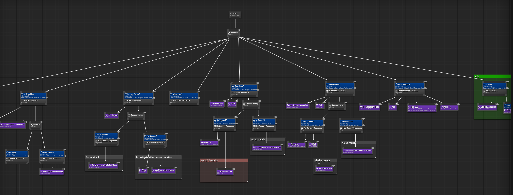

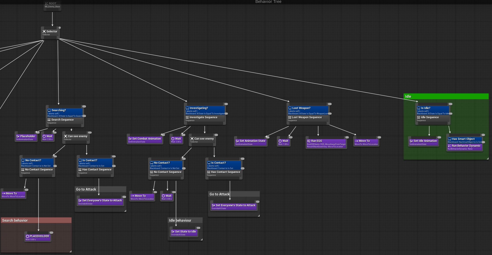

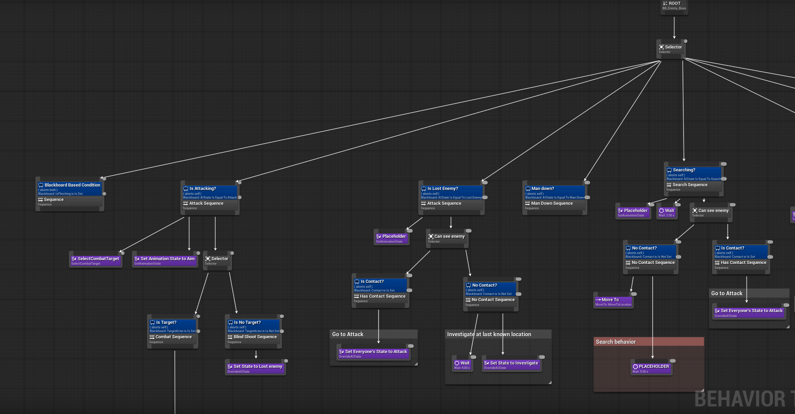

## Overview

Enemy squads run on Behavior Trees and EQS, split across three layers:

| Layer | Class | Decides |
|-------|-------|---------|
| Agent | [`ACAIController`](../Source/Clarity/Private/AI/CAIController.cpp) | Perception, detection level, the agent's own `AIState` / `CombatState`; reports detection to the manager |
| Squad | [`UCAIManagerSubsystem`](../Source/Clarity/Private/AI/CAIManagerSubsystem.cpp) | Squad-wide state changes, the combat loop (who advances) and cover-fire requests |
| Behavior | Behavior Tree + EQS | How each state is executed: movement, cover selection, shooting, reloading |

An agent is an [`ACAICharacter`](../Source/Clarity/Private/AI/CAICharacter.cpp) with:
- a **faction** and a **combat role** (`ECCombatRole`: `Defender` or `Engager`, `Engager` by default);
- its own Behavior Tree asset;
- an optional [smart object](../README.md#smart-objects) for Idle behavior;
- the shared Action System: AI starts the same actions as the player (`Aim`, `Shoot`, `Reload`), and its aim origin and direction come from `ICShooterInterface` (barrel location towards the target).

The Blackboard holds the working state of one agent. Its keys include `AIState`, `CombatState`, `CombatRole`, `TargetActor`, `CoverActor`, `MoveToLocation`, `Contact`, `ShootFromCover`, `IsFlinching` and `HasSmartObject`.

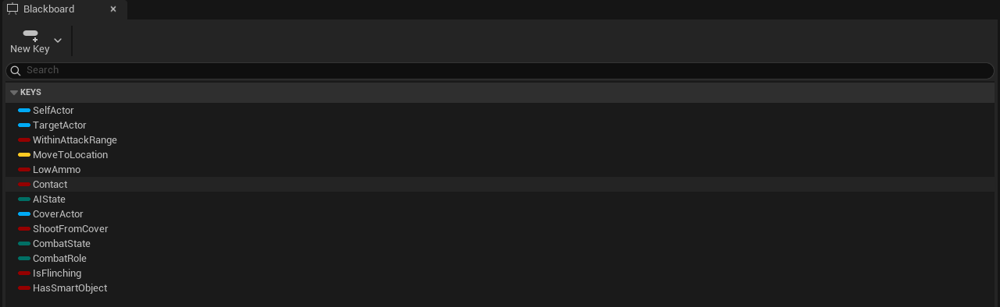

## States

Two enums drive the logic.

**`AIState`** is the overall mode. A new state is accepted only if its priority is equal to or higher than the current one. The enum's integer value is the priority, and a lower value means a higher priority. Every attempt, including rejected ones, is written to `LogClarityAI`.

| Priority value | State | Set by |
|----------------|-------|--------|
| 0 | `ManDown` | The squad manager, to tell about casulties |
| 1 | `WeaponLost` | The controller, on the weapon slots component's `OnWeaponLost` event (for example after a disarm) |
| 2 | `Attack` | The squad manager, when one agent's detection reaches the threshold |
| 3 | `LostEnemy` | The squad manager, when no agent is engaged any more |
| 4 | `Investigate` | The controller, at half of the detection threshold or on a non-sight stimulus |
| 5 | `Search` | the manager runs a search timer for the squad, see below |
| 6 | `Idle` | Initial state; the manager sets it when the search time runs out |

The check only says who wins, not which transitions are legal: a write to a lower-priority state is rejected by definition. The squad leaves `Attack` after combat as any other AI state - by changing the AI State enum.

**`CombatState`** is the sub-mode inside combat: `ApproachingCover`, `HoldCover`, `NeedToReload`, `SoftCover`, `Flank`, `RetreatingToCover`, `Evade`. It is written by the manager (`ApproachingCover`), by services (`NeedToReload`) and by Behavior Tree tasks (`OverrideCombatState`).

## Perception and detection

- **Sight only.** The perception component uses a sight sense that detects enemies and neutrals but not friendlies. Other senses are not configured; a stimulus from another sense would put an agent into `Investigate` (the handling exists in `OnPerception`, behind a `\NOTE`).
- **Hostility** is decided by faction: two factions differ and the other one is not neutral (`ACAICharacter::IsHostile`).
- **On a sight stimulus** from a hostile, the controller sets the `Contact` key, stores the last stimulus location and time, and (unless the squad already attacks) sets the target.
- **Detection is gradual.** While an agent is in `Idle` and has contact, a timer raises its detection level one step at a time:
  - at **half** of the threshold: `Investigate`, moving to the last seen position;
  - at the **full** threshold: the controller reports to the manager, which switches the whole squad to `Attack`;
  - without contact, the level decays step by step down to zero.

  Only the *state* is broadcast to the squad. Each agent selects its own target.

## Squad manager

`UCAIManagerSubsystem` is a world subsystem. It keeps the agents (and separately the `Defender`s) of one faction. Agents are registered once, at world start.

**State broadcast.** `NotifyAIState` tries to set the given state for every agent through `TrySetAIState`. For `Attack` it starts the combat loop; for `Search` it starts the search timer.

**Combat loop.** It runs once per second while the squad is engaged. *Engaged* means that at least one agent has contact, has a target, or received a stimulus within the last `MaxStimulusTime_Combat` seconds. When nobody is engaged, the manager stops the loop and broadcasts `LostEnemy`.

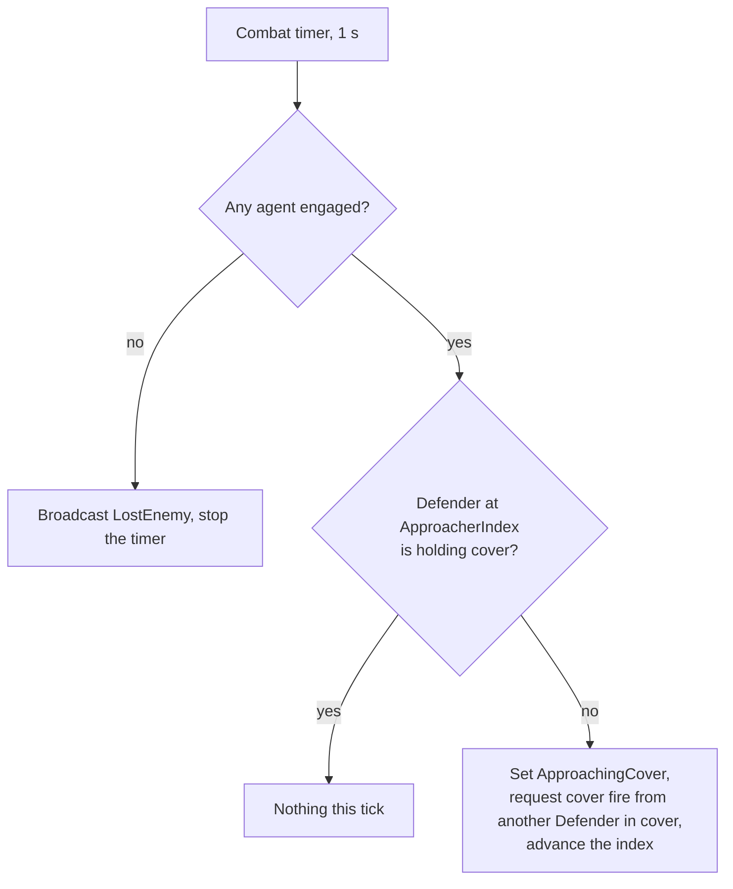

**Cover fire.** `RequestCoverFire(true, Requester)` picks the first other `Defender` that is holding cover and tells it to shoot from cover (`ShootFromCover`). `RequestCoverFire(false, ...)` stops the previous provider. The request is made when a Defender approaches cover and while it reloads. A known issue with how the approacher index advances is listed in [Limitations](../README.md#limitations--roadmap).

**Search.** The search timer runs once per second; after `MaxStimulusTime_Search` seconds the manager broadcasts `Idle`.

## Behavior cycles

The cycles below describe the Behavior Tree assets, which are not part of the repository. See the screenshots.

### Defender

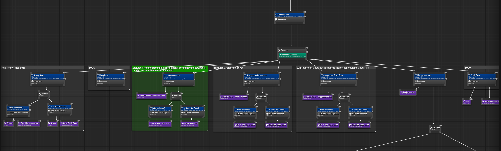

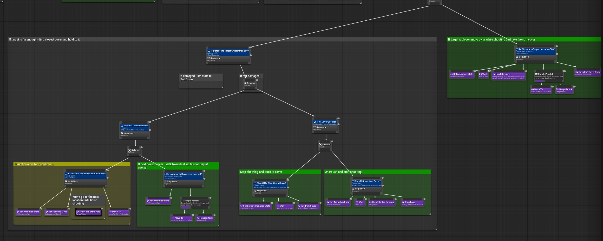

The manager coordinates `Defender`s only.

| Step | Behavior | Implemented by |
|------|----------|----------------|
| 1 | Spot a hostile: contact, target and last seen location are stored | `ACAIController::OnPerception` |
| 2 | At half of the detection threshold, investigate the last seen position | `ACAIController::SetDetectionLevel` |
| 3 | At the threshold, the whole squad goes to `Attack`, and the combat loop starts | `UCAIManagerSubsystem::NotifyAIState` |
| 4 | Find a free cover, scored by EQS | `UCBTTask_SelectCover` |
| 5 | Take it: choose a cover spot that faces the target; cover fire is requested while approaching | `UCBTTask_GetCoverSpot`, `RequestCoverFire` |
| 6 | Sprint if the cover is far; walk and shoot if it is close | `UCBTDecorator_CheckDistance`, `UCBTTask_SetMovementSpeed` |
| 7 | At cover, if the target is too close, run an EQS query to move away and pick another cover, requesting cover fire meanwhile | `UCBTTask_SelectCover`, `RequestCoverFire` |
| 8 | Otherwise hold the cover and shoot only when the manager asks | `ShootFromCover` key, `SetShouldShootFromCover` |

**Reload.** `UCBTService_CheckAmmoLevel` sets `NeedToReload` when ammo falls to `LowAmmoPercentage`. `UCBTTask_Reload` starts the reload action, asks for cover fire from the other Defenders, stays in progress until the action stops, then releases the cover fire.

### Engager

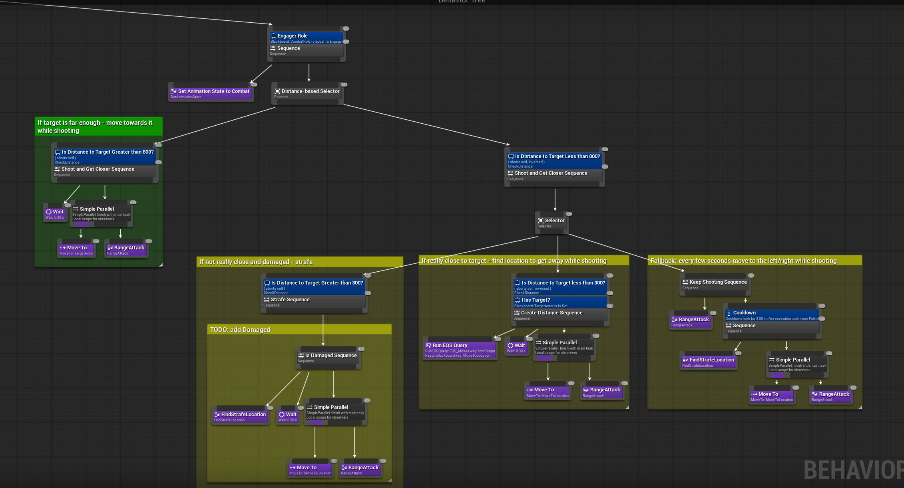

`Engager` is the default role. The manager does not coordinate it.

| Step | Behavior | Implemented by |
|------|----------|----------------|
| 1–3 | The same as the Defender: spot, investigate, squad `Attack` | see above |
| 4 | If the target is far enough, move towards it while shooting | `UCBTTask_RangeAttack` |
| 5 | If it gets too close, the choice depends on the distance and on recent damage (see below) | BT node |

- very close and recently damaged: run an EQS query for a strafe location and strafe while shooting (`UCBTTask_FindStrafeLocation`);
- not that close and not damaged: run an EQS query to create distance, then shoot;
- fallback: strafe on the spot and shoot.

Strafe locations must be farther than `DistanceToTarget` from every agent in the squad, so that squad members keep their spacing.

## Behavior Tree nodes

All nodes live in [`Source/Clarity/Private/AI/`](../Source/Clarity/Private/AI).

| Node | Kind | What it does |
|------|------|--------------|
| `UCBTTask_SelectCombatTarget` | Task | Runs an EQS query and sets the best-scoring hostile as the target |
| `UCBTTask_SelectCover` | Task | Runs an EQS query for covers and picks one by mode (`Approach`, `Reposition`, `Retreat`) and *directness*; reserves it |
| `UCBTTask_GetCoverSpot` | Task | Picks the first cover spot that faces the target within `DesiredAngleToTarget` and writes it to `MoveToLocation` |
| `UCBTTask_FindStrafeLocation` | Task | Runs an EQS query and picks the best location that keeps the distance from all agents |
| `UCBTTask_RangeAttack` | Task | Starts shooting and keeps firing between cooldowns while ammo is above `MagazineThresholdPercentage` |
| `UCBTTask_Reload` | Task | Latent: starts the reload action and finishes when it stops (subscribe in execute, unsubscribe in finish) |
| `UCBTTask_SetAnimationState` | Task | Sets the combat and crouch state, and the focus on a target |
| `UCBTTask_SetMovementSpeed` | Task | Sets the max walk speed by a movement mode (idle, walking, jogging, sprinting) |
| `UCBTTask_GetPathPoints` | Task | Writes the next patrol point as the move target, looping at the end |
| `UCBTTask_OverrideAIState` | Task | Sets `AIState` for this agent or broadcasts it to the squad |
| `UCBTTask_OverrideCombatState` | Task | Writes `CombatState` |
| `UCBTService_CheckAmmoLevel` | Service | Sets `NeedToReload` on low ammo |
| `UCBTService_CheckAttackRange` | Service | Writes whether the target is in range and in line of sight |
| `UCBTDecorator_CheckDistance` | Decorator | Passes when the distance to the actor in a chosen Blackboard key is at least `DistanceToCheck` |

The cover system and the smart objects have their own README sections: [Cover System](../README.md#cover-system), [Smart Objects](../README.md#smart-objects).

## EQS Queries

Find attack location EQS Query.

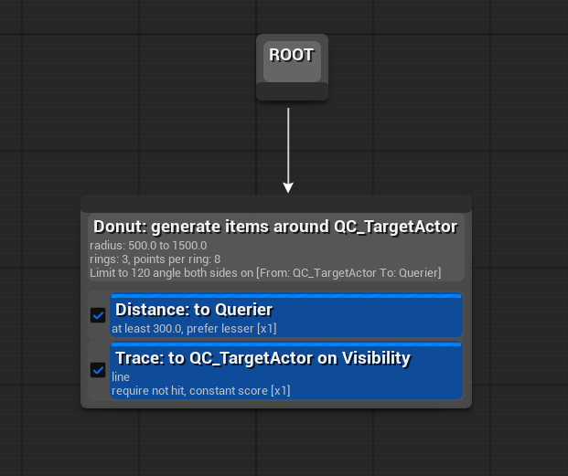

Find nearby cover EQS Query (can be varied).

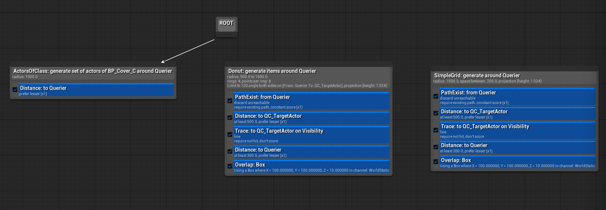

Move away from the target (aka create distance) EQS Query.

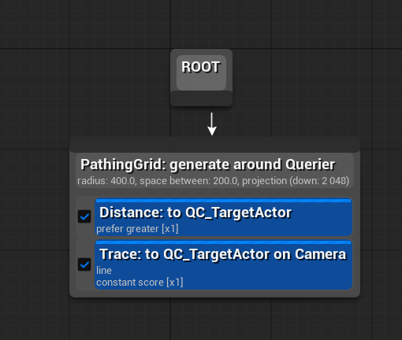

Strafe EQS Query.

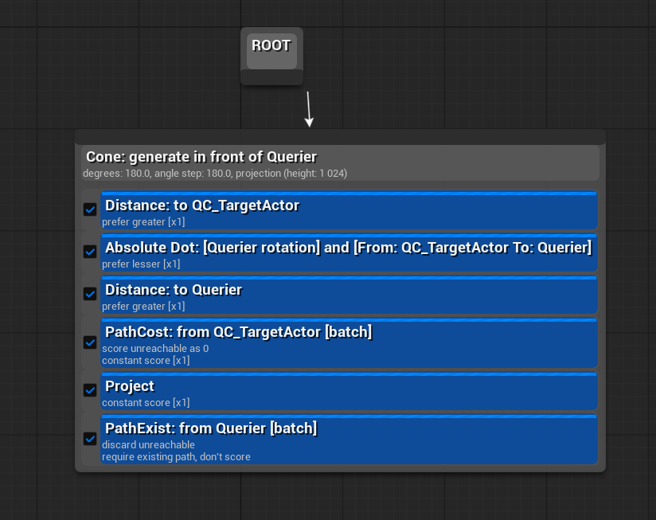

## Reactions and events

- **Damage.** The controller sets `IsFlinching`; it is cleared when the hit-reaction action's tag stops (a tag event). Behavior Tree sets the state to flinching to prevent any actions for a while.
- **Death.** The controller stops the Behavior Tree logic, clears the focus and unregisters the agent from the manager. The character disables collision and movement and is destroyed after 10 seconds.
- **Weapon loss.** The weapon slots component publishes `OnWeaponLost`; the controller switches to `WeaponLost`, which outranks `Attack`.

## Tuning defaults

Defaults in code; some can be overridden in Blueprints.

| Parameter | Default | Meaning |
|-----------|---------|---------|
| Sight radius / lose-sight radius | 2000 / 2500 | Detection range |
| Peripheral vision | 80° | Half-angle of the field of view |
| `DetectionThreshold` | 5 | Steps needed to be certain |
| Detection interval | 1 s (2 s beyond 500 units) | Time per step |
| `MaxStimulusTime_Combat` | 10 s | How long a stimulus keeps the squad engaged |
| `MaxStimulusTime_Search` | 10 s | Search duration before `Idle` |
| Combat loop and search timers | 1 s | Tick of the manager's loops |
| Movement speeds | 100 / 300 / 500 | Walking / jogging / sprinting |
| `MagazineThresholdPercentage` | 10 | Ammo percentage at which the attack task stops firing |
| `DesiredDistance` / `DesiredAngleToTarget` | 500 / 45° | Cover selection and cover spot choice |

## Debugging

- In the Output Log, enable `Log LogClarityAI Verbose` to see state changes (with numeric priorities and rejected writes), the combat loop and the EQS tasks.
- In PIE, the Gameplay Debugger (the apostrophe key by default) shows the Behavior Tree, EQS and Perception of the selected agent.

## Known issues

See the table in the [README](../README.md#limitations--roadmap).
